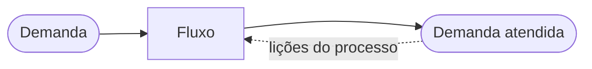
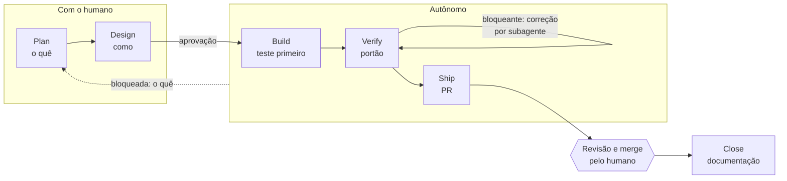
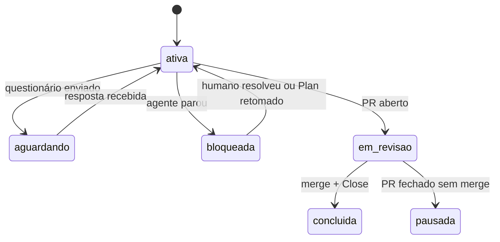

# Fluxo de desenvolvimento com agentes

Skills para Claude Code que levam uma demanda de **ideia a pull request** em cinco estágios: **Plan → Design → Build → Verify → Ship**.

O humano trabalha onde o julgamento dele é insubstituível: **decidir o que construir (Plan) e como construir (Design)**. Do Build em diante, o fluxo segue sem o humano até abrir o PR: um orquestrador chama cada estágio. O humano volta para revisar e fazer o merge.

---

## Sumário

- [A ideia](#a-ideia)
- [O fluxo](#o-fluxo)
- [Os estágios](#os-estágios)
- [As skills](#as-skills)
- [A nota da task](#a-nota-da-task)
- [Tipos e tamanhos](#tipos-e-tamanhos)
- [Autonomia: quando o agente para](#autonomia-quando-o-agente-para)
- [Contrato do orquestrador](#contrato-do-orquestrador)
- [Três camadas: método, ferramenta e contexto](#três-camadas-método-ferramenta-e-contexto)
- [O que cada projeto precisa fornecer](#o-que-cada-projeto-precisa-fornecer)
- [Instalação](#instalação)
- [Uso](#uso)
- [Métricas](#métricas)
- [Próximos passos](#próximos-passos)
- [Créditos e licenças](#créditos-e-licenças)

---

## A ideia

Todo problema de software tem a mesma forma: uma **entrada** (a demanda), um **caminho** e uma **saída** (a demanda atendida). Não existe um caminho único. Ele depende do projeto, da equipe e de quem desenvolve. Por isso este fluxo **não** tenta ser universal: ele é um caminho específico, montado a partir de duas referências e da experiência prática de quem o usa.



Um bom fluxo é:

- **repetível:** o mesmo tipo de demanda passa pelos mesmos passos;
- **verificável:** cada estágio tem um critério de saída;
- **adaptável:** problema de *como* se corrige ali mesmo, por um subagente novo; problema de *o quê* volta ao Plan, com o humano;
- **evolutivo:** o que deu errado numa entrega vira melhoria do próprio fluxo.

Princípios que atravessam todos os estágios:

- **Os fatos são do agente; as decisões são do humano.** O agente nunca pergunta o que pode descobrir no código. Nunca decide no lugar do humano.
- **Evidência, não relato.** "Os testes passaram" só vale com o comando e a saída.
- **Teste primeiro, um teste por vez.**
- **Nenhum passo some em silêncio.** O que não se aplica fica registrado como `skip: <motivo>`.
- **O artefato escrito carrega o contexto, não a conversa.** Cada estágio pode começar numa sessão nova, lendo só a nota da task.

---

## O fluxo



|                    | Plan                    | Design          | Build           | Verify                | Ship      | Close            |
| ------------------ | ----------------------- | --------------- | --------------- | --------------------- | --------- | ---------------- |
| **Pergunta**       | O que construir?        | Como construir? | Construir       | Está certo?           | Entregar  | Registrar        |
| **Humano**         | entrevista + teach-back | aprovação única | —               | —                     | —         | —                |
| **Saída**          | spec                    | design aprovado | código + testes | achados classificados | PR aberto | docs atualizadas |
| **Pode reprovar?** | —                       | —               | —               | **sim** (único)       | —         | —                |

---

## Os estágios

### 1. Plan — `task-plan`

Entrar em acordo sobre **o que** construir antes de qualquer código. O agente investiga os fatos (como o código funciona hoje e por que ficou assim), explica o terreno, entrevista em rodadas (perguntas numeradas, cada uma com resposta recomendada) e confirma o entendimento com um **teach-back**: o humano precisa conseguir explicar a task sem IA. A saída é a spec com a **definição de pronto** no formato "quando…, então…".

### 2. Design — `task-design`

Definir **como** construir. Perguntas em aberto são resolvidas com **protótipo descartável** (três variantes de tela dentro da página real, ou um HTML que exercita a regra de negócio). O agente esboça **duas formas** para o código e escolhe a de interface menor e responsabilidade mais clara. Define o **plano de testes** (um teste por critério de pronto, com a comprovação no app) e até **7 etapas**. Termina com a **última aprovação humana antes do PR**.

### 3. Build — `task-build`

O agente líder escolhe o modelo, prepara a branch, registra uma **linha de base** (testes, lint e build antes de mexer) e delega a um subagente que escreve **um teste, vê falhar pelo motivo certo, escreve o mínimo de código, vê passar**, com um commit local por etapa. O líder confere a evidência, não o relato, e limpa o diff.

### 4. Verify — `task-verify`

O **portão**. Comprova cada critério **no app real**, depois revisa em paralelo com contextos limpos: **Spec** (faz o que foi pedido?), **Padrões** (segue as regras do repositório?), **Ataque ao diff** (só sobrevive o que for provado por execução) e **Raio de impacto** (o que quebra fora do diff). **Quem acha não julga; quem julga precisa provar.** Os achados são classificados: bloqueante é corrigido ali mesmo por um subagente novo do Build (correção por subagente); o que precisa do humano vai para o PR, no máximo 5 itens; o resto fica na nota.

### 5. Ship — `task-ship`

Integra a base, atualiza o changelog do projeto (se houver), faz push e abre o PR no padrão do fluxo, acompanha o CI e registra **lições do processo**, só quando algo aconteceu. **Nunca faz merge.**

### Close — `task-close`

Depois do merge, atualiza a documentação de arquitetura para descrever **como o sistema é hoje**, trata decisões superadas, débitos e pendências, e arquiva a task. Sem argumento, varre todas as tasks em revisão, o que permite rodar como rotina agendada.

---

## As skills

| Skill         | Estágio | Invocação                | Arquivos de apoio                                                                                                     |
| ------------- | ------- | ------------------------ | --------------------------------------------------------------------------------------------------------------------- |
| `task-plan`   | Plan    | `/task-plan <demanda>`   | `tipos/` (fix, feature, refatoração, investigação), `tamanhos/` (épico, mapa), `templates/` (spec, questionário)      |
| `task-design` | Design  | `/task-design <nota>`    | `referencias/` (vocabulário de forma, protótipo de UI, protótipo de lógica, design duas vezes), `templates/design.md` |
| `task-build`  | Build   | orquestrador, após o Design aprovado | `referencias/` (TDD, limpeza), `templates/` (brief do subagente, execução)                                            |
| `task-verify` | Verify  | orquestrador, após o Build  | `referencias/` (app real, revisores), `templates/verificacao.md`                                                      |
| `task-ship`   | Ship    | orquestrador, após o Verify | `referencias/commits.md`, `templates/` (PR, lições)                                                                   |
| `task-close`  | Close   | orquestrador após o merge, ou rotina agendada (`/task-close [nota]`) | —                                                                                                                     |

A pasta `task-comum/` não é skill: guarda as regras comuns do Build, do Verify e do Ship.

Todas usam `disable-model-invocation: true`: só rodam quando chamadas de fora (pelo humano ou por um orquestrador), nunca por iniciativa do modelo. Por isso **uma skill não chama a seguinte**: o Claude Code recusa a chamada de uma skill com essa opção pela ferramenta Skill (testado em 23/11/2026, Claude Code 2.1.330). Cada estágio autônomo termina com uma linha de resultado para o orquestrador (ver [Contrato do orquestrador](#contrato-do-orquestrador)).

### Padrão de commit e PR

Commits e títulos de PR seguem [Conventional Commits](https://www.conventionalcommits.org): `tipo(escopo): assunto`, com o assunto descrevendo comportamento e o rodapé `Task: <ID>`. O corpo do PR tem até ~40 linhas: **Por que**, **O que mudou**, **Evidência**, **Perigo do merge** (dá para voltar atrás? qual o raio de impacto?), **Atenção** e **Sugestões para o projeto** (só se houver). Detalhes em `task-ship/referencias/commits.md` e `task-ship/templates/pr.md`.

---

## A nota da task

Cada task é **uma nota** (Markdown, pensada para Obsidian) que atravessa todos os estágios. Cada estágio lê a nota, acrescenta a sua seção e passa adiante.

| Seção                                                                                                                  | Escrita por             |
| ---------------------------------------------------------------------------------------------------------------------- | ----------------------- |
| Objetivo, Entendimento (com a Prova com dado real), Definição de pronto, Contrato, Decisões, Fora do escopo, Perguntas em aberto, Evidências da investigação | Plan                    |
| Design (perguntas resolvidas, nomes, forma, plano de testes, etapas, desvios)                                          | Design (desvios: Build) |
| Execução                                                                                                               | Build                   |
| Verificação                                                                                                            | Verify                  |
| Entrega                                                                                                                | Ship                    |
| Resultado                                                                                                              | Close                   |
| Registro de etapas (com os `skip`)                                                                                     | todos                   |

### Definição de pronto, Contrato e Registro

- **Definição de pronto:** frases `quando …, então …` em cinco categorias: **feliz**, **erro esperado**, **repetição** (clique duplo, requisições simultâneas), **limite** (zero, vazio, vencido, máximo, dado já gravado fora do padrão, entrada externa com tipo inesperado) e **acesso indevido** (usuário A vendo ou alterando dado de B). Categoria sem uso leva `não se aplica - motivo`. Cada frase vira um teste com o mesmo título.
- **Contrato (`C1`, `C2`…):** o que outra parte do sistema, o banco ou o usuário enxerga e fica fixo: rota, formato, status, campo gravado, permissão, log. **Fora do Contrato, tudo é sugestão** e o agente decide sozinho; mudar o Contrato é mudar o *o quê*, e o agente para.
- **Um lugar por fato:** regra ou valor por extenso só no Contrato; o resto da nota cita `ver C3`.
- **Prova com dado real:** quando a task mexe em regra sobre dado que já existe, a premissa é testada contra o dado antes da entrevista, só em leitura e só com número agregado.
- **Registro de etapas:** uma linha por estágio, em formato fixo (`build: concluido em … · modelo … · rodadas N · desvios N · …`), para medir o fluxo por script (ver [Métricas](#métricas)). O Close escreve a última linha, `close`, com a data do merge e os débitos criados e removidos.

**Ciclo de vida** (frontmatter):



O campo `estagio` (`plan` → `design` → `build` → `verify` → `ship`) diz até onde a task chegou. Uma parada não muda o `estagio`: muda só o `status` (ver `task-comum/regras.md`).

---

## Tipos e tamanhos

O fluxo é o mesmo para tudo; o **conteúdo** de cada estágio muda conforme o tipo e o tamanho.

**Tipo** define _o que provar_:

| Tipo         | Definição de pronto                                                      | O que vem antes de tudo                                    |
| ------------ | ------------------------------------------------------------------------ | ---------------------------------------------------------- |
| fix          | o sintoma exato reproduz (vermelho) e depois deixa de reproduzir (verde) | montar o ciclo de feedback: um comando que reproduz o bug  |
| refatoração  | comportamento igual **e** leitura mais fácil                             | travar o comportamento com testes antes de mover estrutura |
| feature      | frases nas 5 categorias + Contrato                                       | termos do domínio e forma dos dados                        |
| investigação | pergunta respondida com fontes                                           | delimitar a pergunta (sem código)                          |

**Tamanho** define _como dividir_:

| Tamanho | Quando                                    | O que vira                                                                                                        |
| ------- | ----------------------------------------- | ----------------------------------------------------------------------------------------------------------------- |
| task    | cabe numa sessão                          | uma nota                                                                                                          |
| épico   | o caminho é claro, mas não cabe numa task | nota-mãe + uma nota por **fatia vertical** (cada fatia atravessa todas as camadas e pode ser demonstrada sozinha) |
| mapa    | ainda há decisões grandes em aberto       | nota de mapa + notas de **decisão**; quando o caminho fica claro, vira épico                                      |

A unidade que passa por Design → Build → Verify → Ship é sempre uma nota com `tamanho: task`.

---

## Autonomia: quando o agente para

Do Build ao Ship, o agente **não pergunta**: decide, registra o motivo e segue. Ele só para, marca a task como `bloqueada` e termina com a linha `RESULTADO` quando o problema é de **o quê** (Contrato, escopo, produto), quando o passo não tem volta, quando há dúvida de segurança ou permissão, ou quando as tentativas de correção se esgotam. Problema de **como** não para o fluxo: um subagente novo corrige ali mesmo (correção por subagente).

A lista completa dos casos, os casos próprios do Ship, os limites de tentativas por estágio, o formato da saída e a reentrada ficam num lugar só: [`task-comum/regras.md`](task-comum/regras.md).

O que precisa do olho humano, mas não justifica parar, vai para a seção **Atenção** do PR.

---

## Contrato do orquestrador

O método não depende de um orquestrador específico. Serve qualquer um que cumpra este contrato.

- **Workspace e branch.** O orquestrador (ferramenta) cria o workspace da task depois da aprovação do Design. O Build (método) cria a branch nesse workspace, ou usa a branch da task se o workspace já estiver nela, e a mantém até o Ship. Verify e Ship conferem que estão na branch registrada na Execução.
- **Entrada.** O humano roda Plan e Design com o orquestrador. Depois, o orquestrador chama um worker por estágio (Build, Verify, Ship), cada um numa sessão nova, e passa só o caminho da nota. O worker lê a nota, o contexto do projeto e os commits da branch. Só a nota e os commits passam de um estágio para o outro.
- **Saída.** Todo estágio autônomo termina com a linha `RESULTADO`, inclusive numa parada. O orquestrador decide pela linha e pelo estado da nota (`status` e `estagio`): `concluido` chama o próximo estágio; `bloqueada` chama o humano. Linha ausente ou que contradiz a nota conta como `bloqueada`.
- **Close.** Depois do merge do PR pelo humano, o orquestrador chama `/task-close <nota>`, ou uma rotina agendada roda `/task-close` sem argumento. No repositório sem PR, o orquestrador chama o Close logo depois do Ship.
- **Reentrada.** Depois de `bloqueada`, quem resolve e qual estágio roda de novo depende do caso: ver [`task-comum/regras.md`](task-comum/regras.md).

---

## Três camadas: método, ferramenta e contexto

| Camada                  | O que é                                                   | Onde fica                                       |
| ----------------------- | --------------------------------------------------------- | ----------------------------------------------- |
| **Método**              | como planejar, construir, verificar e entregar            | estas skills (iguais para qualquer projeto)     |
| **Ferramenta**          | como usar Git, GitHub, Obsidian, o vault                  | skills de ferramenta e MCPs                     |
| **Contexto do projeto** | comandos, branches, caminhos, convenções, lentes próprias | memória do agente e `CLAUDE.md` de cada projeto |

As skills **não citam nenhum projeto**. Tudo o que é específico vem do contexto.

---

## O que cada projeto precisa fornecer

Checklist do contexto que as skills leem (memória do agente ou `CLAUDE.md`):

- [ ] **Vault:** caminho, pasta de tasks (pendentes e concluídas), prefixo de ID, glossário, notas de arquitetura, decisões, lista de débitos técnicos, nota de lições do fluxo, verificação automática (se houver)
- [ ] **Git:** branch base, convenção de nome de branch, branches protegidas, estratégia de merge (squash recomendado: o commit vermelho do fix não chega à base), repositórios do projeto
- [ ] **Repositórios sem PR:** quais publicam direto na branch principal (ex.: o vault), com qual ferramenta e com qual vocabulário de mensagem de commit por estágio
- [ ] **Comandos** por subprojeto: teste, lint, build, type check
- [ ] **Testes:** guia de testes, banco de teste, limitações conhecidas (ex.: sem teste de componente)
- [ ] **Verificação no app:** skill `verify` do projeto, ambiente isolado, conta de teste
- [ ] **Cópia isolada para revisores:** só se o projeto precisar de um jeito diferente do padrão (pasta temporária do sistema ou da sessão, fora de qualquer repositório, nunca no clone principal nem no workspace de outra frente), por exemplo para instalar as dependências da cópia de forma mais barata
- [ ] **Lentes do projeto** para o revisor de Padrões (ex.: "ação de negócio gera log de auditoria")
- [ ] **Changelog para o usuário final:** arquivo, formato e regras de curadoria (se houver)
- [ ] **CI:** existe? quais checks?
- [ ] **Idioma** de commits e PRs
- [ ] **Desenhos:** pasta para diagramas (opcional)

---

## Instalação

As skills se referenciam entre si (por exemplo, o Build usa o padrão de commit do Ship), então **instale as seis juntas, com a pasta `task-comum`**. Essa pasta não é skill (não tem `SKILL.md`): guarda as regras comuns do Build, do Verify e do Ship (`task-comum/regras.md`), que as skills citam por caminho relativo. O `task-*` dos comandos abaixo já a inclui.

**Para todos os seus projetos** (pessoal):

```bash
git clone <url-deste-repositorio> ~/fluxo-skills
cp -r ~/fluxo-skills/task-* ~/.claude/skills/
```

**Só para um projeto** (versionado com ele):

```bash
cp -r ~/fluxo-skills/task-* <projeto>/.claude/skills/
```

Confirme na documentação do Claude Code da sua versão o local exato das skills.

---

## Uso

```text
/task-plan <descreva a demanda>     # entrevista, teach-back, spec
/task-design <nota>                 # protótipo se precisar, forma, testes, etapas, aprovação
                                    # do Build ao Ship, o orquestrador chama cada estágio:
claude -p "/task-build <nota>"      # sessão nova; termina com RESULTADO
claude -p "/task-verify <nota>"     # só se o anterior terminou com "concluido"
claude -p "/task-ship <nota>"       # abre o PR
                                    # ... revisão e merge do PR pelo humano ...
/task-close                         # fecha as tasks com PR mergeado
```

A última linha de cada estágio autônomo segue um formato fixo (`RESULTADO: <estagio> concluido|bloqueada - ...`), definido em `task-comum/regras.md`. A fonte da verdade continua sendo a nota (`status` e `estagio` no frontmatter); a linha só evita que o orquestrador interprete texto livre. Como o orquestrador usa a linha: ver [Contrato do orquestrador](#contrato-do-orquestrador). Em `claude -p` não há como aprovar permissões durante a execução: libere antes os comandos de git, `gh`, teste, lint e build do projeto.

---

## Métricas

`scripts/metricas.py` lê as notas de task e o histórico git do vault e gera um relatório mensal (`metricas-AAAA-MM.json` e `.md`). Só Python 3 com a biblioteca padrão; só leitura no vault; escreve apenas na pasta de saída.

```text
python scripts/metricas.py --config <arquivo.json> --mes AAAA-MM [--meses-anteriores 2] --saida <pasta> [--sem-gh]
python -m unittest discover scripts/tests
```

O config (modelo em `scripts/metricas.config.example.json`) tem o caminho do vault, a pasta das tasks, a pasta das concluídas, o ramo do git do vault (padrão `main`) e os repositórios GitHub (`dono/repo`).

**Mesmas definições do painel de confiança.** Quatro indicadores usam exatamente as regras do `.scripts/confianca.py` do vault e saem marcados "(mesma definição do confianca.py)": revisão sem bloqueante, divergências por task, horas do início ao PR e escapes. O recorte também é o dele: notas da pasta de concluídas pela `concluida_em` no mês, fluxo novo e antigo somados, épico, mapa e decisão fora. Mudou a regra lá, mude aqui.

- **Escapes:** fix concluído no mês com `origem` = ID de task conta como escape daquela task. Fix sem `origem`, ou com `anterior ao fluxo` ou `externa`, fica fora da conta e aparece em "sem dado".
- **Horas do início ao PR:** do 1º commit `<ID>: plan` ou `<ID>: design` ao 1º `<ID>: ship` (novo); do 1º `<ID>: nova task` ao 1º `PR aberto` ou `publicada` (antigo).

Os demais indicadores contam as tasks com atividade no mês (commit do vault com o ID ou `concluida_em` no mês), em quatro grupos, separando fluxo novo (com Registro) e fluxo antigo (só retrabalho):

- **A nota acertou?** Contrato ou Definição de pronto alterados depois do commit `<ID>: design`, paradas em `bloqueada`.
- **O fluxo andou bem?** Intervalo entre commits de estágios consecutivos, cobertura dos commits de estágio, retrabalho, autonomia do Build ao Ship, dados do PR via `gh`. Os intervalos **não são tempo de trabalho**: nem todo estágio ganha commit e os commits saem em rajada.
- **O Verify acertou?** Problemas achados depois do Verify (CI vermelho, CHANGES_REQUESTED, escape), refutados sobre candidatos, itens de Atenção.
- **A nota está bem formada?** As 5 categorias da Definição de pronto, Contrato válido (`C1`, ou fatia de épico que cita um `C<n>` ou a nota-mãe), Prova com dado real, Registro em formato válido, skips com motivo.

A saída tem só IDs e números, nunca texto da nota. Com N < 10, não há percentual: só a contagem e os IDs.

**Os indicadores servem para achar onde olhar, não são meta.** Número fora do padrão é convite para ler a nota, não nota de desempenho.

---

## Próximos passos

- [ ] Skills de setup: `fluxo-setup` (coordenador), `projeto-contexto`, `vault-setup`, `vault-sync`, `verify-setup`
- [ ] Rotina agendada para o `task-close`
- [ ] Ataque ao diff com outra família de modelo, quando houver outra CLI disponível

---

## Créditos e licenças

O fluxo adapta ideias e trechos (traduzidos e resumidos) de três coleções de skills, todas sob licença MIT:

- **[mattpocock/skills](https://github.com/mattpocock/skills)**, de Matt Pocock: entrevista em rodadas, modelagem de domínio, spec, fatias verticais, mapa de decisões, protótipos, design de módulos profundos, TDD, diagnóstico de bugs, revisão em dois eixos, formato de PR, retrospectiva.
- **[pstack](https://github.com/cursor/plugins/tree/main/pstack)**, de Lauren Tan (port para Claude Code: [pstack-claude](https://github.com/michael-denyer/pstack-claude)): `how`/`why`/`teach`, playbooks por tipo, `architect`, TDD pragmático, limpeza do diff, skill de verificação do app, ataque ao diff, raio de impacto, números, acompanhamento de PR.
- **[cursor-team-kit](https://github.com/cursor/plugins/tree/main/cursor-team-kit)**, plugin irmão do pstack (Cursor, MIT): `deslop` (limpeza do diff), `fix-ci`, `make-pr-easy-to-review`, `thermo-nuclear-code-quality-review`.

Cada skill tem um `NOTICE.md` com o detalhe do que foi adaptado e uma pasta `licencas/` com o texto das licenças. As licenças MIT exigem manter o aviso de copyright e o texto da licença em cópias ou partes substanciais. Confirme os termos vigentes nos repositórios de origem. Isto não é parecer jurídico.

Mapas usados como referência na pesquisa: [super-board](https://erictechpro.github.io/super-board/).
